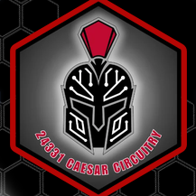

FTC 24331 · Caesar Circuitry

# Project ALEA

A Monte Carlo shot simulator for BIOBUZZ 2026-27. **72 million shots in 72 seconds** on one NVIDIA L4 told us **when to shoot**, **what to tune** and **which hood to keep**.

[Read the summary](summary.md){ .ep-btn }
[Knowledge base](knowledge-base.md){ .ep-btn .ep-ghost }

<b>100%</b>of 10,000 test shots match the Java Code Sim

<b>~1M</b>shots per second on one L4

<b>1,610</b>field spots swept

<b>72</b>error conditions tested

## Where to start {.ep-h}

[<b>Summary</b>The one-page version: the problem, the key numbers and what ALEA changed.](summary.md){ .ep-tile }
[<b>Knowledge base</b>Every number with its source, and how each result was checked.](knowledge-base.md){ .ep-tile }
[<b>Technical binder</b>The judge-facing write-up of the simulator.](technical-binder.md){ .ep-tile }
[<b>Robot interface</b>What a robot must log so ALEA can read it.](robot-interface.md){ .ep-tile }
[<b>Decisions</b>Why the project is built the way it is, one record per choice.](decisions/README.md){ .ep-tile }

## Where it is going {.ep-h}

Each phase has its own folder in the repository. The goal of each one:

<ol class="ep-timeline">
<li><b>Phase 0 · Data contract</b>Every robot log and match result lands in one database. <code>robot/</code> · <code>alea/data/</code></li>
<li><b>Phase 1 · Shot simulator</b>Monte Carlo studies on Brev GPUs, with results in notebooks. <code>alea/sim/</code> · <code>alea/game/</code> · <code>hpc/</code></li>
<li><b>Phase 1b · High fidelity</b>dsim's pure hive logic is ported and replayed against dsim traces; ball contacts and the 3D hive are not, and <code>fidelity: hifi</code> runs the fast kernel plus hive sessions on the ported logic. <code>alea/hifi/</code></li>
<li><b>Phase 2 · Video review</b>Camera calibration from field landmarks, click-and-log of each launch, exit speed and efficiency from video; tracking last, on GPU machines only. <code>alea/video/</code></li>
<li><b>Phases 3-5 · Analysis</b>Calibrate the sim on real shots, driver critique, robot health. <code>alea/analysis/</code></li>
<li><b>Phase 6 · Web app</b>Streamlit for the team, a FastAPI service later. <code>alea/web/</code></li>
<li><b>Phase 7 · Match simulation</b>Full auto and match simulation on top of the shot simulator. <code>alea/matchsim/</code></li>
</ol>

<small>**Roadmap phase:** all. This folder holds the knowledge base, technical binder, robot interface contract and decision records. Build it with `just docs`.</small>
