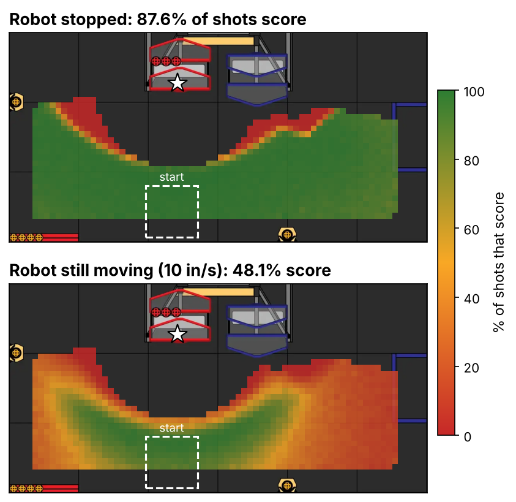
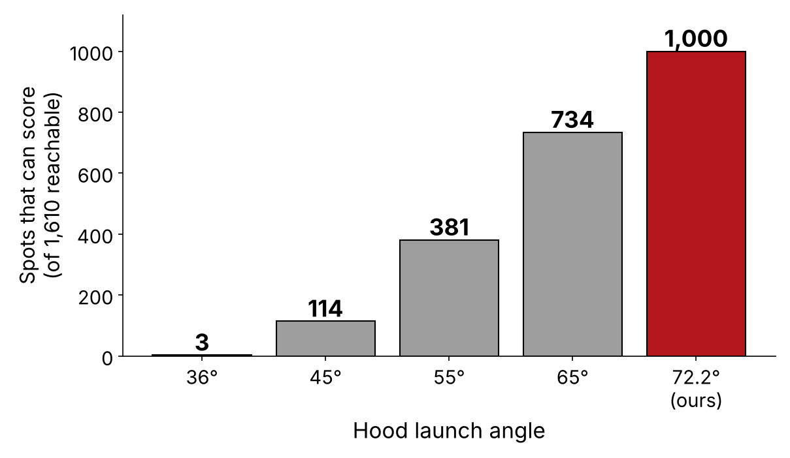
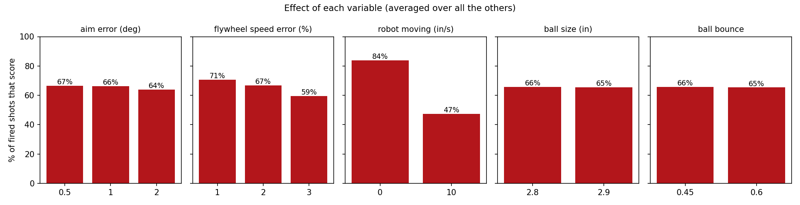

# Project ALEA · Summary 24331

**Problem:** Robot time is limited, and testing every idea on the real robot is slow. Like **NASA and Formula 1**, we test in **simulation first**, so we catch bugs and make **decisions with math** before we ever touch the robot.

<b>72M</b>shots simulated

<b>72 s</b>on one NVIDIA L4

<b>87.6%</b>score when stopped

<b>48.1%</b>score while moving

ALEA is the team's Monte Carlo shot simulator for BIOBUZZ 2026-27. The numbers and their sources
are in the [knowledge base](knowledge-base.md); the judge-facing version is the
[technical binder](technical-binder.md).

## How We Use Simulation

| Tool | Question | When | Process | Output |
|---|---|---|---|---|
| Code Sim | "Does our code work?" | After every code change | Runs our **real robot code** in the sim | Bugs fixed **before robot time** |
| Project ALEA | "What's our best play?" | When the robot changes | **Monte Carlo:** 72M shots on an NVIDIA cloud GPU | Advice for **drivers** and **designers** |

## ALEA Results: Stop Before Launch

**72 million shots in 72 seconds** on an NVIDIA L4 cloud GPU (72 conditions × 1,000,000 each). Shooting while moving drops scoring from **88% to 48%**, so **drivers stop before every shot**.

## Hood Angle Analysis

ALEA swept every reachable spot at every flywheel speed. A flat **36°** hood scores from only **3 of 1,610 spots**; our **72.2° curved hood** scores from **1,000 (62%)**. **Decision: keep the curved hood.**

## Math: Projectile Motion

z(x) = h₀ + x · tan θ − g · x² / (2 · v² · cos² θ)

To score, the ball has to be **coming down** when it reaches the cell's mouth (**53.5–65.6 in** up). A 36° hood only gets it that high from 75+ in away. Ours does it from 24 in. Our **hand math matched ALEA**.

## Effect of Each Error Source

Flywheel error matters too: **PIDF must hold within 2%**. Our **1° aim tolerance** and **ball wear** each cost **under 1 point**.

## Risk Mitigation & Lessons Learned {.ep-black}

We only trust the sim when it matches reality. The field comes from **FIRST's official CAD**, and we checked our shots against **match videos of other goBILDA StarterBots**. **Lesson learned:** the videos showed robots scoring where our sim said they couldn't, which led us to a **wrong hood angle**. After fixing it, **the sim matched the footage**. ALEA also caught our robot firing from **2 spots that always miss**, so we **tightened our aim limit**. Results are **simulated until confirmed on the robot**.

